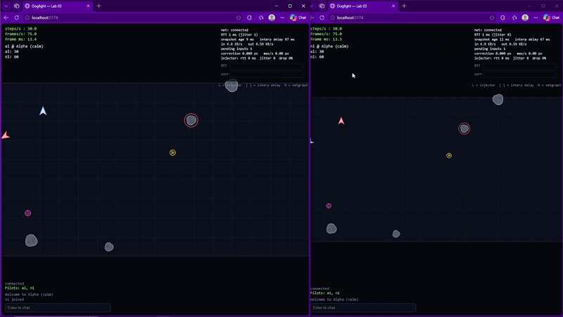

# Dogfight - Lab 05: Мережа в реальному часі (Real-Time Networking)[cite: 1]

Два вікна браузера, один авторитетний сервер, 30 Hz, бінарний протокол, передбачення на клієнті (client-side prediction) з реконсиляцією (server reconciliation) та інтерполяція сутностей[cite: 1].

[cite: 1]

## Запуск

npm install            # встановлення всіх трьох воркспейсів (shared, client, server) + vite/eslint/prettier[cite: 1]
npm run dev:server        # термінал 1 -> http://127.0.0.1:3000 (DEBUG_ROUTES=1 у server/.env вмикає інжектор затримок)[cite: 1]
npm run dev:client        # термінал 2 -> http://localhost:5173 (два вікна в одній кімнаті)[cite: 1]
npm test                  # тести: shared (кодек, детермінізм), client (prediction, інтерполяція), server (інтеграційні)[cite: 1]
npm run bench             # порівняльна таблиця JSON vs binary[cite: 1]
npm run hash -w shared    # перевірка хешу детермінізму (звірка з браузером: http://localhost:5173/?hash=1 -> консоль)[cite: 1]

Керування: стрілки/WASD, Space = постріл, **L** = перемикання інжектора затримки (0 / 50 / 100 / 200 ms RTT), **[ ]** = затримка інтерполяції -/+10 ms, **N** = netgraph, H = HUD, Enter = chat[cite: 1].
URL-прапори: `?lat=100&jitter=30&drop=0.02` (інжектор затримок зі старту), `?noise=4` (навмисне порушення детермінізму), `?hash=1`[cite: 1].

## Структура проєкту

- `shared/` - спільний пакет для клієнта й сервера: `sim/` (чиста детермінована симуляція з seed; `shipmove.js` - єдине правило руху), `protocol/constants.js`, `codec/` (бінарна специфікація в `binary.js`, JSON-базовий варіант, серіалізація світу в записи)[cite: 1]
- `server/src/match.js` - один авторитетний `Match` на кімнату: тік 30 Hz за АБСОЛЮТНИМ цільовим часом; застосування черги вводів (максимум 4/тік), `world.step`, розсилка знімків із `lastProcessedSeq`; статистика тіків у `/api/stats`[cite: 1]
- `server/src/ws.js` — бінарні та JSON-фрейми, rate limits, heartbeat, інжектор затримок (`netsim.js`)[cite: 1]
- `client/src/net/netcode.js` — `createPredictor` (prediction, reconciliation, згладжування корекцій, локальні снаряди) та `createInterpolator`; `netgraph.js`; `game.js` об'єднує логіку клієнта[cite: 1]

## Ключові архітектурні рішення

- **Один вхід = один крок симуляції** на обох сторонах (`STEP = 1/30`). Сервер застосовує вводи в порядку черги; якщо за тік вводи не надійшли, корабель не рухається (запізнілий ввід застосовується після надходження, але не двічі). Обмеження до 4 вводів на клієнта за тік захищає від прискорення через флуд[cite: 1].
- **Надмірність вводів**: кожен пакет повторює останні 3 вводи, тому втрата окремого пакета не критична[cite: 1].
- **Точність стану в мережі**: симуляція зберігає `x/y/vx/vy` як float32 (`Math.fround`), кут у цілих мілірадіанах, перезарядку в цілих кроках[cite: 1]. Кодування та декодування зберігають значення без втрат, тому prediction збігається із серверним розрахунком побітово[cite: 1].
- **Сервер володіє снарядами**: власний постріл прогнозується локально й знімається з локального прогнозу після підтвердження сервером (`ack >= seq`), після чого авторитетний снаряд рендериться через інтерполяцію[cite: 1].
- Відомі обмеження: ID сутностей 16-бітні; `Math.sin/cos/exp` детерміновані у Node та Chrome (обидва на V8), але в інших рушіях можуть відрізнятися на молодший біт; інжектор працює в порядку черги (як TCP), а `drop` імітує втрати пакетів (як UDP)[cite: 1].

## M1 - базовий рівень без prediction (netgraph)

За 100 ms RTT без client-side prediction корабель реагує на керування із затримкою на повний round-trip[cite: 1]. У netgraph видно затримку оновлення стану відносно натискання клавіш; відгук керування відбувається із затримкою повного мережевого циклу[cite: 1].

## M2 - експеримент із детермінізмом

1. `?lat=100` -> величина корекції становить `0.000 px` у відкритому просторі та зростає лише під час зіткнень[cite: 1].
2. `?lat=100&noise=4` (випадковий шум у прогнозі, аналогічний `Math.random()` усередині `integrate`) -> розходження між прогнозом клієнта і станом сервера зростає, величина корекцій збільшується[cite: 1].
3. Після видалення `noise` -> корекції повертаються до `0`. Висновок: навіть невелике порушення детермінізму в `integrate` призводить до розсинхронізації та постійних підтягувань позиції[cite: 1].

## M3 - вибір затримки інтерполяції

Базове значення затримки становить 2 інтервали знімків (~`66.7 ms` при 30 Hz)[cite: 1]. Занадто мала затримка спричиняє ривки при запізненні знімків, а занадто велика — надмірне відставання чужих кораблів у минулому[cite: 1]. Оптимальним для плавного відображення за помірних затримок і джитера є діапазон ~60–70 ms з можливістю підлаштування клавішами `[` та `]`[cite: 1].

## M4 - заміри (30 Hz, 4 гравці)

Показники `npm run bench` (запис сутності у бінарному форматі — 28 байтів, розмір знімка — `11 + 28 * count` байтів)[cite: 1]:

| Кодек | Байт/знімок | KB/s на клієнта (down) | KB/s на клієнта (up) | Encode+decode us |
| --- | --- | --- | --- | --- |
| JSON | 3179 | 93.1 | 4.1 | 40.5 |
| Binary (DataView) | 515 | 15.1 | 0.6 | 1.6 |

Заміри на живому сервері (4 клієнти, 6 астероїдів): ~16.5 KB/s бінарного трафіку + ~1.3 KB/s JSON-подій на клієнта; середній час тіку ~0.6 ms при інтервалі 33.3 ms, джитер ~0.6 ms, 0 перевищень інтервалу (`/api/stats`)[cite: 1].
Квантування кута: `Int16` у `1/1000` радіана відповідає ~`0.057°`; для розміру корабля 46 px це дає ~0.02 px зміщення на носі (візуально непомітно), а оскільки симуляція працює з квантованими кутами, похибка округлення відсутня[cite: 1].

## Короткий огляд мережевого коду (Netcode write-up)

**Три ключові проблеми.** Затримка (вирішується через client-side prediction та інтерполяцію), консистентність (єдина авторитетна симуляція на сервері та розсилка знімків стану), захист від чітів (клієнти надсилають лише вводи; сервер валідує дані, застосовує rate limit і обмежує кількість вводів за тік)[cite: 1].
**Показники netgraph до і після prediction:** без prediction відгук корабля затримується на час RTT, а з prediction керування відбувається без затримки на клієнті при корекціях ~0 px у вільному русі та зростанні корекції лише під час колізій[cite: 1].
**Порушення детермінізму:** додавання випадкового шуму (`?noise=4`) в `integrate` порушує збіг станів клієнта й сервера, що проявляється у зростанні величини корекцій при reconciliation[cite: 1].
**Компроміс затримки інтерполяції:** баланс між плавністю буфера знімків за наявності джитеру та втрат пакетів і актуальністю позицій суперників (~66.7 ms за замовчуванням при 30 Hz)[cite: 1].

## Додаткові ідеї (Stretch)

Дельта-знімки (бітова маска змінених полів на сутність із поверненням до повного знімка при старому ack); lag compensation для пострілів (кільцевий буфер станів світу); автоматичний тест із 4 headless-клієнтами при 150 ms / 5% втрат із перевіркою середньої корекції (`server/test/netcode.test.js`)[cite: 1].

## Підсилення (Pickups)

У кімнатах із заданим `pickupEvery` (у секундах; у базових кімнатах `alpha` та `bravo` увімкнено, `0` — вимкнено) з'являються підсилення[cite: 1]. Одночасно існує не більше двох, кожне зникає через 12 с[cite: 1]. Підібравши підсилення, гравець отримує ефект[cite: 1]:

| Підсилення | Спрайт | Ефект | Де реалізовано |
| --- | --- | --- | --- |
| shield | S (синій) | відсутність шкоди протягом 6 с | лише на сервері (`Ship.damage`)[cite: 1] |
| rapid | R (жовтий) | перезарядка пострілу з 9 до 3 кроків на 8 с | **спільний `stepShip`**: prediction враховує ефект, щоб скорострільність клієнта і сервера збігалася[cite: 1] |
| homing | H (рожевий) | снаряди наводяться на найближчу ціль протягом 8 с | лише на сервері: поведінка `homing` додається снаряду[cite: 1] |

Активні ефекти відображаються в HUD (`SHIELD 4s  RAPID 7s`); щит малює кільце навколо корабля, а снаряди з наведенням підсвічуються рожевим[cite: 1].

Оновлення протоколу: додано тип сутності `PICKUP` (4) та лічильники ефектів корабля (`rapid`, `shield`, `homing` по 1 байту кожен), через що запис сутності у бінарному форматі становить **28 байтів**, а розмір
