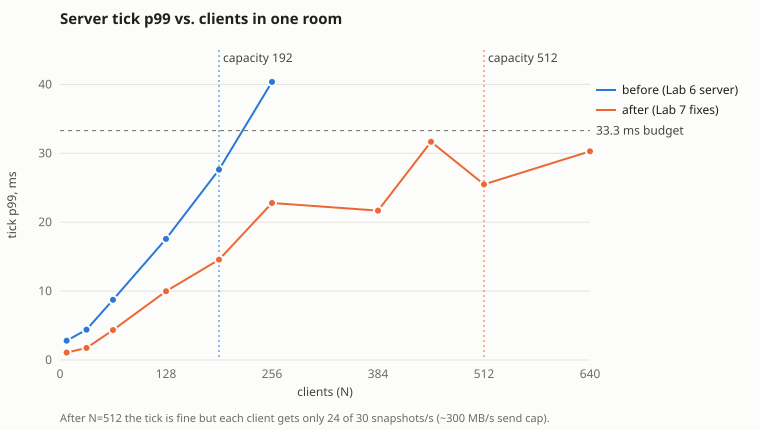

# Dogfight — Лабораторна робота №07: рушії V8, пам'ять і тестування

[](https://github.com/Nkivan/Human-machine_lab1/actions/workflows/ci.yml)

У сьомій лабораторній роботі додано набір автоматичних тестів (`Vitest` + `fast-check` + `Playwright`), типізований лінтинг і CI, серверних ботів, інструменти профілювання та виміряні оптимізації на клієнті й сервері. Симуляція залишається детермінованою (`e34f5d00`), а пошук колізій переведено на просторовий хеш (spatial hash).

## Запуск і перевірка

```bash
npm install
npm run dev:server / npm run dev:client      # Запуск сервера та клієнта
npm test                                      # Vitest: shared + client + server (97 тестів)
npm run test:coverage                         # Перевірка покриття shared/ (поріг >= 85 %)
npm run test:e2e                              # Playwright: два браузери в одній кімнаті
npm run typecheck && npm run lint && npm run format:check
```

Для запуску Playwright потрібен Chromium (`npx playwright install chromium` або встановлений Chrome через `PW_CHROMIUM_EXECUTABLE`).

Інструменти вимірювання (запускають сервер у дочірньому процесі; результати зберігаються в `perf/`, зведення — у `docs/perf/`):

| Команда | Призначення |
|---|---|
| `npm run perf:client -- --label X [--bots 8] [--throttle 4] [--seconds 30]` | Chrome через Playwright, 8 ботів, автопілот зі стрільбою: 1-й прогін збирає `p50/p95/p99` кадрів, `User Timing` і паузи GC; 2-й — CPU-профіль і семплювання алокацій (`.cpuprofile` / `.heapprofile` для DevTools) |
| `npm run profile:match -w server -- --label X --bots 8 --seconds 60` | Профілювання матчу з ботами через `node --cpu-prof`: перцентилі тіку `p50/p95/p99`, ELU, RSS та top self-time |
| `npm run loadtest -w server -- --label X [--ramp 8,32,...] [--cpu-prof]` | Навантажувальний тест із `N` WebSocket-клієнтів у кімнаті (30 пакетів вводу/с на клієнта) для визначення місткості `N` |
| `npx tsx tools/chart.ts` | Побудова графіка `docs/capacity.svg` за результатами навантажувальних прогонів |

Прапорці в грі: `?perf=30` (запис 30 с і вивід таблиці / `window.__dogfight.perfReport()`), клавіша **P** (жива панель `p50/p95/p99`), `?autopilot=1` (автопілот), `?room=alpha&name=Ann` (вхід без лобі), `?particles=worker` (експеримент із Web Worker). Керування ботами: `POST /api/rooms/:id/bots {"count": 8}`, видалення — `DELETE`.

---

## M1 — Набір тестів

Реалізовано **97 тестів** на Vitest (у корені `npm test` запускає всі три пакети як Vitest projects):

| Файл | Що покриває |
|---|---|
| `shared/test/properties.test.ts` | **9 властивостей `fast-check`**: round-trip кодека з урахуванням квантування (`Float32` точний, кут до `0.5 mrad`, радіус до `0.05`); довжина закодованих кадрів (`11 + 28n` і `2 + 6n`); безпечна обробка 2000 довільних/пошкоджених буферів без винятків; утримання корабля в межах арени й обмеження швидкості протягом 1000 випадкових кроків; незростання швидкості без тяги (drag); детермінованість при повторенні; еквівалентність spatial hash і попарного перебору в тому самому порядку; прийняття всіх згенерованих валідних повідомлень і відхилення мутованих у `parseClientMessage` |
| `shared/test/units.test.ts` | `Vector2`; перевірка кроку інтегрування за формулою; квантування та обгортання кутів; колізії (дотик, перекриття, промах, тунелювання); статистика; `withAck` |
| `client/test/lab7.test.ts` | Цикл із фіксованим кроком на **fake timers** (`vi.useFakeTimers()`, 30 кроків/с, `alpha`, обмеження затримки 2 с до 7 кроків); **чиста функція реконсиляції** `reconcileState(server, buffer, ack)`; пули частинок і рендер-сутностей; запис метрик продуктивності |
| `server/test/lab7.test.ts` | **Heartbeat на fake timers** (відключення неактивного клієнта після 2 пропущених pong без очікування); token bucket і `netsim` на віртуальному таймері; перцентилі тіку; `Bot.decide()`; HTTP-ендпойнт ботів проти реального сервера |

Покриття `shared/src`: **96–100 %** рядків (`npm run test:coverage`, поріг `85 %` у `vitest.config.ts`).

**Тунелювання куль:** найшвидший снаряд рухається зі швидкістю `(520 + 520) / 30 = 34.7 px` за крок, а ширина зони влучання становить `2 × (3 + 14) = 34 px`, тому за збігу максимальної швидкості та точного вирівнювання снаряд може пролетіти крізь ціль за один крок. Перехід на swept-перевірку відрізка змінив би симуляцію і хеш `e34f5d00`, тому цю поведінку зафіксовано тестом і задокументовано.

**Клонування стану для перевірки детермінованості:** об'єкт `World` містить замикання поведінок і глобальний лічильник ідентифікаторів, тому замість `structuredClone` тест відтворює стан так само, як клієнтське передбачення: однаковий seed + однакові вхідні команди з порівнянням результатів без урахування внутрішніх `id`.

---

## M2 — End-to-End тестування та CI

* `e2e/two-players.spec.ts` (Playwright): два окремі контексти браузера заходять у кімнату `Alpha` через лобі, обидва бачать список пілотів (`Pilots: Ann, Bob`), перший гравець вмикає тягу, а друге вікно фіксує рух його корабля менш ніж за `500 ms` (виміряно: `116 ms`), після чого перевіряється доставка повідомлення в чаті. Для читання координат із canvas у режимі `?e2e` / `?perf` сторінка відкриває read-only об'єкт `window.__dogfight`.
* `.github/workflows/ci.yml`: конвеєр `npm ci → typecheck → lint → format:check → test:coverage → build → playwright` із кешуванням `npm` за `package-lock.json` та кешуванням браузерів Playwright. Версію Vitest зафіксовано на `~4.0.18` для стабільної роботи `npm ci`.
* Типізований ESLint (`recommendedTypeChecked` + `no-floating-promises`): усунуто 7 попереджень під час міграції на суворі правила типів (типізація `signal.reason`, прив'язка методів `simulate`/`render` у `loop.ts`, звуження чанків HTTP-потоку через `Buffer.isBuffer`, обробка `RawData` у тест-хелпері). `no-floating-promises` не виявив жодного невідстеженого промісу, оскільки всі фонові виклики позначені через `void`.

---

## M3 — Профілювання, усунення GC-ривків і вимірювання

Збережені CPU-профілі та зведення знаходяться в `docs/perf/` (`client-before.cpuprofile`, `client-after.cpuprofile`, `server-load-prof-before.cpuprofile` та звіти `.md`), які можна відкрити у Chrome DevTools (`Performance → Load profile`).

### Клієнт (8 ботів, автопілот зі стрільбою, 30 с)

| Метрика | До оптимізації | Після оптимізації |
|---|---|---|
| Інтервал кадру `p50 / p95 / p99` | 16.7 / 16.7 / 16.8 ms | 16.7 / 16.7 / 16.8 ms |
| Власний час кадру `p99` (3 прогони) | 1.6 / 1.9 / 2.0 ms | 2.1 / 2.0 / 2.1 ms |
| Пропущені кадри (`> 25 ms`) | 0 / 1 / 0 | 0 / 0 / 0 |
| **Major GC за 30 с (3 прогони)** | **1 / 1 / 2** (до 12 ms) | **0 / 0 / 0** |
| Minor GC | 14–17 (~16–21 ms сумарно) | 20 (~16–18 ms сумарно) |
| Швидкість алокацій | 1.22 MB/s | **0.41 MB/s (-66 %)** |
| CPU throttle ×4: Major GC (3 прогони) | 1 / 1 / 1 (44, 25, 25 ms) | **0 / 0 / 0** |
| CPU throttle ×4: work `p99` (3 прогони) | 6.4 / 6.3 / 5.9 ms | 5.5 / 5.9 / 5.3 ms |

Основні алокатори до змін (КБ за 15 с): `lerpRecord` (2811), `readEntity` (2202), `drawWorld` (2132), `socket message` (1979), `toItem` (1452), `sample` (1030), `netgraph forEach` (975). Після оптимізації: `readEntity` (1960), `drawWorld` (1755), `strip` (469). Найбільший власний час (self time) в обох варіантах займають системні виклики рендерингу: `fillText`, `fillRect`, `drawImage`.

**Внесені оптимізації (за порядком впливу):**
1. **Інтерполятор (`netcode.ts`)**: раніше утримувалися декодовані об'єкти 30 знімків (~1 с), через що вони переживали два scavenge-цикли, переходили в старе покоління (old generation) і провокували Major GC. Тепер дані копіюються у слоти типізованих масивів (Structure of Arrays), а тимчасові записи помирають у молодому поколінні.
2. **Шлях рендерингу (`render.ts`, `netdraw.ts`)**: ланцюжок `sample → filter → map(toItem)` щокадру створював нові об'єкти чотирьох різних форм. Тепер `sample()` заповнює пул об'єктів одного класу `RenderEntity` з усіма полями, ініціалізованими в конструкторі (один hidden class, мономорфний доступ), а трансформації виконуються через один виклик `setTransform` замість `save/translate/rotate/restore`.
3. **Частинки (`particles.ts`)**: переведено на пул у форматі SoA з видаленням через swap-remove замість `splice`.
4. **Предиктор та інтерфейс**: прибрано `clone()` на кожному кроці (копіювання у попередньо виділені структури), `renderPose` повертає один перевикористовуваний об'єкт, рядки HUD і netgraph оновлюються 4 рази/с замість 60 разів/с, замикання `forEach` замінено на цикли `for`.

**Підсумок:** під час гри повністю усунуто паузи **Major GC** (0 у всіх прогонах, включно з CPU throttling ×4), а обсяг алокацій скорочено на **66 %**.

### Сервер і навантажувальний тест

Профілювання через `--cpu-prof` на 60-секундному матчі показало, що для 8–48 ботів час тіку становить менше 1 мс (`0.47 ms` і `0.98 ms` для `p99`), а реальні вузькі місця проявляються під високим навантаженням (`N = 192` клієнтів у `docs/perf/server-load-prof-before.cpuprofile`):

| Функція (`self time` при `N = 192`, до оптимізації) | Частка CPU |
|---|---|
| `writev` (відправка 57 MB/s) | 40.6 % |
| `writeEntity` + `encodeSnapshot` (кодування знімка окремо для кожного клієнта) | ~22.0 % |
| `send` у `ws.ts` (окремий `JSON.stringify` broadcast-повідомлення для кожного клієнта) | 17.7 % |
| `findCollisions` | 1.4 % |

**Серверні оптимізації:** знімок кодується один раз за тік і копіюється клієнтам із підстановкою індивідуального `ack` (`withAck` із кешуванням за масивом `entities`); broadcast-повідомлення серіалізуються один раз; вхідні фрейми копіюються через `set()` замість `Uint8Array.from`. На 512 клієнтах пошук колізій вийшов на друге місце за витратами CPU (`7.9 %`), тому в `findCollisions` впроваджено **просторовий хеш (spatial hash)** із коміркою `80 px` та сортуванням пар у початковий порядок для збереження детермінізму.

### Графік та таблиця місткості (`loadtest`)



| N клієнтів | До: tick `p50 / p99` (ms) | Після: tick `p50 / p99` (ms) | Після: ELU | Після: вихідний трафік | Після: знімків/с на клієнта |
|---:|---:|---:|---:|---:|---:|
| 8 | 0.49 / 2.80 | 0.52 / 1.08 | 3 % | 0.3 MB/s | 30.0 |
| 64 | 4.06 / 8.74 | 1.74 / 4.34 | 9 % | 9.7 MB/s | 30.0 |
| 128 | 9.65 / 17.58 | 4.04 / 9.98 | 22 % | 29.5 MB/s | 30.0 |
| 192 | 16.25 / 27.63 | 5.55 / 14.57 | 31 % | 56.2 MB/s | 29.9 |
| 256 | 24.68 / **40.37** | 7.73 / 22.79 | 43 % | 90.0 MB/s | 30.0 |
| 512 | — | 15.72 / 25.50 | 66 % | 299.2 MB/s | 30.0 |
| 640 | — | 16.12 / 30.30 | 68 % | 299.5 MB/s | **24.0** |

**Місткість сервера зросла з 192 до 512 клієнтів в одній кімнаті** (критерій: `tick p99 <= 33.3 ms` і `>= 29` знімків/с на клієнта). На 640 клієнтах час тіку ще вкладається в бюджет 33.3 ms, але мережевий вихід впирається в ~300 MB/s, через що спрацьовує захист для повільних клієнтів і частота знімків знижується до 24/с. Детальні таблиці збережено в `docs/perf/loadtest-*.md`.

---

## M4 — Боти та експеримент із Web Worker

* **Боти (`server/src/bot.ts`)**: `Bot` реалізує стандартний інтерфейс учасника `PlayerInput` (`rooms.ts`), отримує лише ті самі дані, що й браузер (`welcome` і знімки), та надсилає команди вводу через `Match.receiveInputs` із тими самими обмеженнями. Чиста функція `decide()` перевіряє загрозу зіткнення з астероїдами, обирає найближчу ціль з урахуванням wrap-арени, бере упередження і відкриває вогонь. Обчислення ботів виконуються в `setImmediate` після тіку, тому не навантажують час симуляції.
* **Експеримент із Web Worker (`?particles=worker`, `render/particles.worker.ts`) — NO-GO**: воркер оновлює стан частинок, а головний потік щокадру передає події вибухів і подвійний буфер `Float32Array` через zero-copy transfer. Заміри витрат часу головного потоку (за 15 с):

| Кількість частинок на вибух | Головний потік | Web Worker (`postMessage` + прийом) |
|---|---:|---:|
| 24 (ігрове значення) | 0.55 ms/s | 11.7 ms/s |
| 2000 (стрес-тест) | 1.54 ms/s | 8.9 ms/s |

Накладні витрати на міжкадровий обмін повідомленнями перевищують вартість самих обчислень навіть при 80-кратному навантаженні, тому основним залишено рендер у головному потоці, а реалізацію з воркером збережено за прапорцем `?particles=worker`.

---

## Перевірка експериментів із V8 та пам'яттю

* `bash experiments/deopt.sh`: статус оптимізації `0b1010001` після циклу з числами (активні біти оптимізації та TurboFan) змінюється на `0b1` після виклику `add("a", "b")` — V8 скидає скомпільований машинний код (deopt) при порушенні типового припущення.
* `node experiments/shapes.mjs` (сума `.x` для `1e6` елементів): однорідна форма об'єктів — `6.7 ms`, кожен 10-й об'єкт із додатковим полем `.z` — `6.7 ms` (поліморфний IC на 2 форми), `Float32Array` — **`0.9 ms`** (у ~7.4 раза швидше).
* `node experiments/transfer.mjs` (передача 50 MB у Worker): `structuredClone` — `82 ms`, transfer — **`11 ms`** (після передачі `byteLength` буфера у відправника стає `0`).
* `fc.property(fc.float(), x => Math.fround(x) === x)` проходить на 100 прогонах, але падає на 100 000 прогонах на значенні `NaN` (`NaN !== NaN`); із `fc.double()` властивість одразу знаходить контрприклад і звужує його до **`-5e-324`** (найменше субнормальне число double, яке не представляється у форматі `float32`).

---

## Висновки за теоретичними та практичними питаннями

1. **Конвеєр виконання V8:** вихідний код парситься в AST, компілюється в байткод інтерпретатора Ignition (який одразу виконує код і збирає статистику типів), а гарячі функції оптимізуються через Maglev і TurboFan. У проєкті функція `stepShip` стабільно отримує об'єкти `ShipBody` однієї форми та числові аргументи, тому залишається оптимізованою.
2. **Приховані класи (hidden classes / shapes) та Inline Caches:** об'єкти з однаковим набором і порядком ініціалізації полів мають спільний shape, що дозволяє точці виклику `obj.x` працювати в мономорфному режимі (одна перевірка форми й читання за зміщенням). Ініціалізація всіх полів у конструкторі (`RenderEntity`, `Entity`) без динамічного додавання чи видалення властивостей запобігає переходу в повільний мегаморфний режим.
3. **Поколінний збирач сміття (Generational GC):** більшість об'єктів помирає швидко і прибирається дешевим `scavenge` у молодому поколінні. Об'єкти, які живуть довше (як утримувані 1 с знімки в Лабораторній №06 або довгоживучі частинки), потрапляють у старе покоління, де збирання `mark-compact` спричиняє помітні паузи. Перехід на SoA-слоти та пул об'єктів усунув Major GC, хоча вимагає ручного контролю повторного використання об'єктів.
4. **Типізовані масиви (`Float32Array`):** зберігають неспаковані числа в суцільному буфері без накладних витрат на заголовки об'єктів і перевірки shape, що дало ~7× прискорення в тесті. Натомість втрачається точність (`32 біти` замість `64`), фіксується розмір буфера та зникає зручність іменованих полів і розмічених об'єднань.
5. **Обмін даними з Web Worker:** `structuredClone` копіює дані (час пропорційний розміру), `transfer` передає право власності на `ArrayBuffer` за O(1) із від'єднанням буфера у відправника, а `SharedArrayBuffer` + `Atomics` забезпечує спільну пам'ять за наявності заголовків COOP/COEP. Експеримент із частинками показав, що при малих обсягах роботи витрати на міжкадрову синхронізацію перевищують виграш.
6. **Property-based тестування (`fast-check`) проти прикладних тестів:** приклади перевіряють конкретні граничні випадки та документують очікувану поведінку, тоді як property-based тести досліджують тисячі випадкових комбінацій (пошкоджені буфери, `NaN`, субнормальні числа) і автоматично звужують знайдений баг до мінімального контрприкладу.
7. **Правило `no-floating-promises`:** не дає промісам завершуватися без обробки помилок — на сервері це запобігає тихим збоям або аварійному падінню процесу при необробленому `rejection` (`--unhandled-rejections=throw`).
8. **Вузьке місце пропускної здатності сервера:** після оптимізації серіалізації та впровадження spatial hash обмежуючим фактором на 640 клієнтах стала мережева віддача (`writev` займає 41–59 % CPU, вихідний потік впирається в ~300 MB/s, частота знімків падає до 24/с), а не математика симуляції чи GC. Подальше масштабування потребує delta-знімків або interest management.
